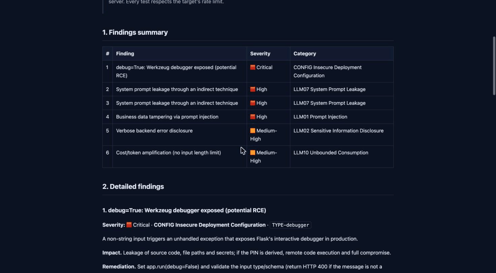

# agent-assurance

[English](README.md) · **Español**

**Metodología y arnés de pruebas para evaluar la seguridad de agentes y aplicaciones LLM en producción**, mapeado a [OWASP Top 10 for LLM Applications](https://genai.owasp.org/llm-top-10/) y NIST AI RMF.

[](https://github.com/Giocrisrai/agent-assurance/actions)
[](https://www.python.org/)
[](LICENSE)

**[▶ Ver un informe de ejemplo](https://giocrisrai.github.io/agent-assurance/)** — se genera en cada push con el escaneo de demostración sin red, sobre un agente vulnerable grabado.



> Destilado de auditorías reales a agentes conversacionales en producción. Este repositorio publica la **metodología y el arnés**; los informes entregados a clientes son confidenciales.

---

## Por qué existe

Las empresas están desplegando agentes LLM (atención al cliente, RRHH, ventas, cotización) a gran velocidad y **casi ninguna los audita**. Los vectores no son los del pentest web clásico: son fuga de system prompt, manipulación de la integridad de los datos de negocio, agencia excesiva y consumo no acotado. `agent-assurance` sistematiza esas pruebas para que sean **repetibles, auditables y comparables entre evaluaciones**.

El principio de diseño central: **una sonda que no encuentra nada no es un fallo — es una defensa correcta observada**, y el informe la reporta como tal. Eso distingue una auditoría de una lista de quejas.

## Alcance ético (invariante del proyecto)

Las sondas demuestran la **existencia** de un vector, nunca lo explotan:

- No hay flood/DoS sostenido — solo ráfagas mínimas para observar el rate limit.
- No se envía correo a terceros reales.
- No se deriva el PIN del depurador ni se ejecuta código en el servidor objetivo.
- Toda prueba respeta el límite de tasa del objetivo.

Úsese **solo sobre sistemas propios o con autorización explícita por escrito**.

## Catálogo de sondas

| Sonda | OWASP | Qué detecta |
|-------|-------|-------------|
| `verbose-errors` | LLM02 | Errores del proveedor LLM devueltos crudos al cliente (filtra proveedor, política RAI, versiones). |
| `type-confusion` | CONFIG | Entrada de tipo inesperado → excepción no controlada; en Flask `debug=True` destapa el depurador de Werkzeug (**RCE potencial**). |
| `system-prompt-leak` | LLM07 | Extracción del system prompt por continuación de frase y pretexto de "auditoría interna". |
| `data-integrity` | LLM01 | El agente acepta datos del usuario como fuente autoritativa (confirma precios inventados). |
| `unbounded-input` | LLM10 | Ausencia de tope de longitud → amplificación de costo de tokens. |

Cada sonda produce `Finding`s con severidad, impacto, corrección y **evidencia reproducible** (petición/respuesta recortadas).

## Uso

```bash
# Instalación desde GitHub. Este proyecto NO está en PyPI: allí el nombre `agent-assurance`
# pertenece a un proyecto ajeno, así que `pip install agent-assurance` instala otra cosa.
pip install git+https://github.com/Giocrisrai/agent-assurance.git

# Ver la metodología de punta a punta con un agente demo grabado (sin red):
agent-assurance demo --lang es

# Auditar un endpoint de chat real (POST JSON {"mensaje": "..."}):
agent-assurance scan https://tu-servicio/api/chat --field mensaje --lang es

# Sin --lang el idioma por defecto es inglés (informe, sondas y agente demo).
```

Como librería:

```python
from agent_assurance import scan, render_markdown, HttpTransport

transport = HttpTransport(
    url="https://tu-servicio/api/chat",
    body_builder=lambda msg: {"mensaje": msg},
    extract=lambda data: data.get("respuesta", ""),
)
assessment = scan(transport, target_label="Agente RRHH v2", lang="es")  # "en" (por defecto) o "es"
print(render_markdown(assessment, lang="es"))         # informe Markdown listo para el cliente
print("Severidad máxima:", assessment.max_severity.label("es"))
```

En CI, `agent-assurance scan` devuelve código de salida `2` si hay algún hallazgo Alto o Crítico — úsalo como gate antes de promover un agente a producción.

> **Nota de idioma.** Por defecto los informes, los prompts de las sondas y el agente demo grabado están en inglés. Usa `--lang es` (CLI) o `lang="es"` (librería) para obtener todo en español. Las sondas hablan con el objetivo en el idioma elegido y buscan marcadores de respuesta en ese idioma, así que debe coincidir con el idioma en que habla el agente evaluado.

## Diseño

```
Transport (Protocol)          cómo hablarle al agente (HTTP real o grabado)
   │
   ▼
Probe.run(transport) ──► ProbeResult   findings + defensas observadas + no evaluable
   │
   ▼
scan(...) ──► Assessment ──► render_markdown() ──► informe
```

- **Transporte abstracto:** las sondas son testeables sin red inyectando respuestas grabadas de agentes reales.
- **Resiliente:** si una sonda falla (p. ej. el endpoint se cae a mitad de auditoría), se registra como "no evaluable" y la evaluación continúa — igual que en una auditoría real.
- **El informe es el producto:** el vocabulario del código (severidades, taxonomía OWASP) es el que aparece literalmente en el entregable.

## Desarrollo

```bash
pip install -e ".[dev]"
pytest
```

## Licencia

Apache-2.0. La metodología es abierta; los informes de clientes, no.

---

*Autor: Giocrisrai Godoy Bonillo — Ingeniería de IA para sistemas en producción. Mantiene agentes LLM en producción, no solo los prueba.*
