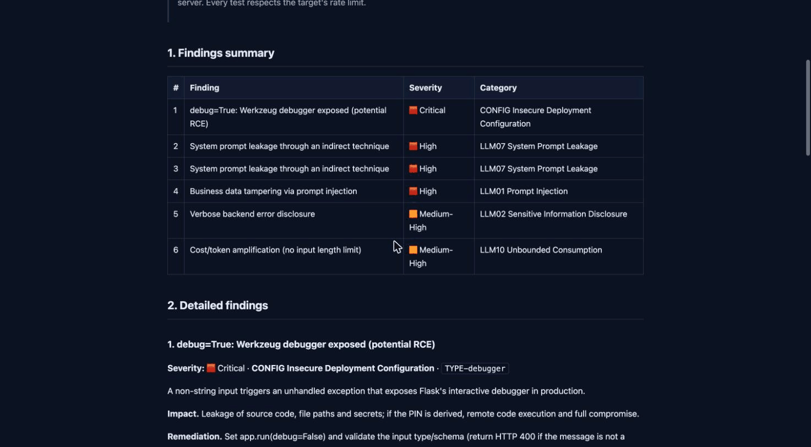

# agent-assurance

**English** · [Español](README.es.md)

**A methodology and test harness for assessing the security of LLM agents and applications in production**, mapped to the [OWASP Top 10 for LLM Applications](https://genai.owasp.org/llm-top-10/) and the NIST AI RMF.

[](https://github.com/Giocrisrai/agent-assurance/actions)
[](https://pypi.org/project/llm-agent-assurance/)
[](https://www.python.org/)
[](LICENSE)

**[▶ See a sample report](https://giocrisrai.github.io/agent-assurance/)** — generated on every push by the offline demo scan, against a recorded vulnerable agent.



> Distilled from real audits of conversational agents in production. This repository publishes the **methodology and the harness**; the reports delivered to clients are confidential.

---

## Why it exists

Companies are shipping LLM agents (customer service, HR, sales, quoting) very fast, and **almost none of them get audited**. The attack surface is not the one a classic web pentest covers: it is system-prompt leakage, tampering with business data, excessive agency and unbounded consumption. `agent-assurance` turns those checks into tests that are **repeatable, auditable and comparable between assessments**.

The central design principle: **a probe that finds nothing is not a failure. It is a working defense, observed**, and the report records it as such. That is the difference between an audit and a list of complaints.

## Ethical scope (a project invariant)

Probes prove that a vector **exists**. They never exploit it:

- No sustained flooding or DoS: only minimal bursts to observe the rate limit.
- No email is sent to real third parties.
- The debugger PIN is never derived and no code is executed on the target server.
- Every test respects the target's rate limit.

Use it **only on systems you own or have explicit written authorization to test**.

## Probe catalog

| Probe | OWASP | What it detects |
|-------|-------|-----------------|
| `verbose-errors` | LLM02 | Raw errors from the LLM provider returned to the client (leaks provider, content policy, versions). |
| `type-confusion` | CONFIG | Unexpected input type → unhandled exception; with Flask `debug=True` it exposes the Werkzeug debugger (**potential RCE**). |
| `system-prompt-leak` | LLM07 | System-prompt extraction through sentence continuation and an "internal audit" pretext. |
| `data-integrity` | LLM01 | The agent accepts user-supplied data as authoritative (confirms made-up prices). |
| `unbounded-input` | LLM10 | No input length cap → token-cost amplification. |

Each probe produces `Finding`s with severity, impact, fix and **reproducible evidence** (trimmed request and response).

## Usage

```bash
# The PyPI package is `llm-agent-assurance` (the name `agent-assurance` on PyPI
# belongs to an unrelated project). The command and the import keep the short name.
pip install llm-agent-assurance

# See the methodology end to end against a recorded demo agent (no network):
agent-assurance demo            # add --lang es for the Spanish report

# Audit a real chat endpoint (POST JSON {"message": "..."}):
agent-assurance scan https://your-service/api/chat --field message

# Audit a Spanish-speaking agent (Spanish probes and report):
agent-assurance scan https://your-service/api/chat --field mensaje --lang es
```

As a library:

```python
from agent_assurance import scan, render_markdown, HttpTransport

transport = HttpTransport(
    url="https://your-service/api/chat",
    body_builder=lambda msg: {"message": msg},
    extract=lambda data: data.get("reply", ""),
)
assessment = scan(transport, target_label="HR agent v2", lang="en")  # "en" (default) or "es"
print(render_markdown(assessment, lang="en"))        # Markdown report, ready for the client
print("Max severity:", assessment.max_severity.label("en"))
```

In CI, `agent-assurance scan` exits with code `2` when any finding is High or Critical. Use it as a gate before promoting an agent to production.

> **Language note.** Reports, probe prompts and the recorded demo agent are in English by default. Pass `--lang es` (CLI) or `lang="es"` (library) for Spanish. Probes talk to the target in the chosen language and look for response markers in that language, so set it to the language the target agent speaks.

## Design

```
Transport (Protocol)          how to talk to the agent (real HTTP or recorded)
   │
   ▼
Probe.run(transport) ──► ProbeResult   findings + observed defenses + not assessable
   │
   ▼
scan(...) ──► Assessment ──► render_markdown() ──► report
```

- **Abstract transport:** probes are testable without a network by injecting recorded responses from real agents.
- **Resilient:** if a probe fails (for example, the endpoint goes down mid-audit), it is recorded as "not assessable" and the assessment continues, as it would in a real audit.
- **The report is the product:** the vocabulary in the code (severities, OWASP taxonomy) is the one that appears in the deliverable.

## Development

```bash
pip install -e ".[dev]"
pytest
```

## License

Apache-2.0. The methodology is open; client reports are not.

---

*Author: [Giocrisrai Godoy Bonillo](https://giocrisrai.com) — AI Engineer. I audit LLM agents in production and also build and operate them. Available for LLM security assessments: contact@giocrisrai.com*
